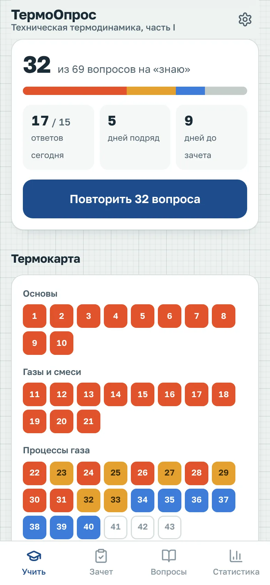
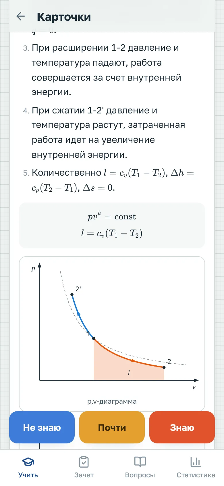
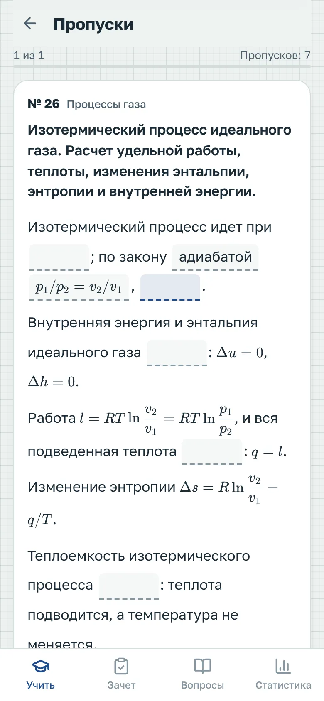
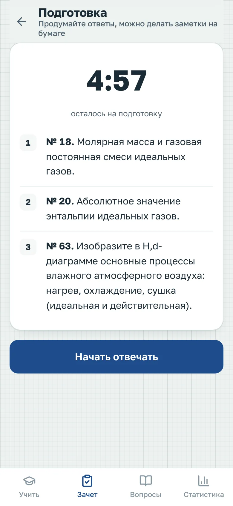
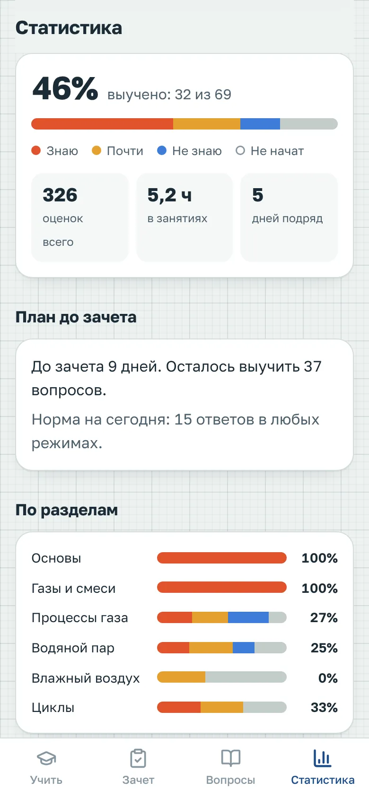
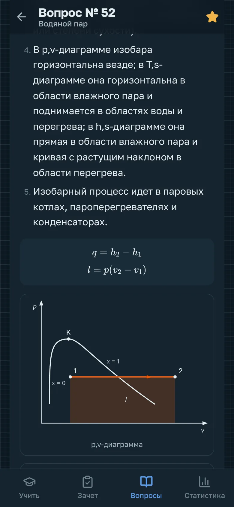
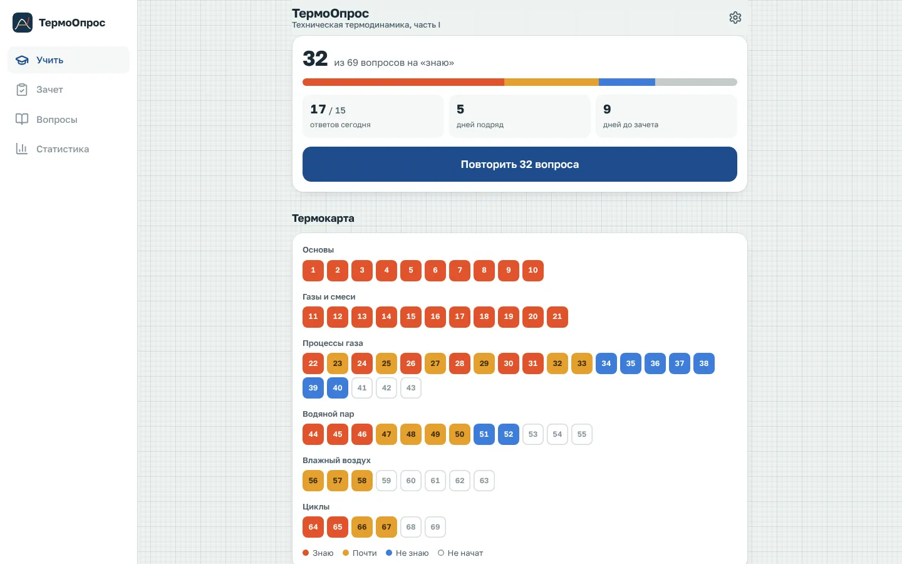

# ТермоОпрос

**69 вопросов зачёта по технической термодинамике: ответы, схемы и тренировки.**

На главном экране термокарта: 69 клеток, по одной на вопрос, а цвет показывает, насколько вопрос выучен.
Без регистрации и облака: всё хранится только на твоём устройстве.

### [Открыть приложение](https://thermo-poll.whiskm.workers.dev/) · [Скачать для Android и Windows](../../releases/latest)

iPhone · Android · Windows · любой браузер

<table>
  <tr>
    <td></td>
    <td></td>
    <td></td>
  </tr>
  <tr>
    <td></td>
    <td></td>
    <td></td>
  </tr>
</table>

## Установка

| Устройство | Как установить |
|---|---|
| **iPhone и iPad** | Открыть [сайт](https://thermo-poll.whiskm.workers.dev/) в Safari → «Поделиться» → «На экран „Домой“» |
| **Android** | Скачать `TermoOpros-….apk` из [последнего релиза](../../releases/latest) |
| **Windows 10 и 11** | Скачать и запустить `TermoOpros-…-setup.exe` из [последнего релиза](../../releases/latest) |
| **Любой компьютер** | Просто [открыть сайт](https://thermo-poll.whiskm.workers.dev/) в браузере |

<b>iPhone и iPad</b>: подробно

App Store не нужен:

1. Открой в **Safari**: **[thermo-poll.whiskm.workers.dev](https://thermo-poll.whiskm.workers.dev/)**.
2. Нажми «Поделиться», затем **«На экран „Домой“»** и «Добавить».
3. ТермоОпрос откроется как обычное приложение, на весь экран, и будет работать без интернета.

Занимайся уже в приложении со значка, а не в Safari: у значка на экране «Домой» своя память, и прогресс из вкладки Safari в нём не появится. Если прогресс уже есть в Safari, перенеси его файлом (см. [Перенос на другое устройство](#перенос-на-другое-устройство)).

<b>Android</b>: подробно

1. Открой [последний релиз](../../releases/latest) и скачай `TermoOpros-….apk`.
2. Открой файл. Если телефон спросит, разреши установку из этого источника.

Новые версии ставятся так же, поверх старой: прогресс сохраняется.

Не хочешь ставить файл? Открой [сайт](https://thermo-poll.whiskm.workers.dev/) в Chrome → меню ⋮ → «Установить приложение».

<b>Windows</b>: подробно

1. Открой [последний релиз](../../releases/latest) и скачай файл, который заканчивается на `-setup.exe`.
2. Запусти его. Права администратора не нужны.
3. Если Windows покажет «Система Windows защитила ваш компьютер», нажми **«Подробнее» → «Выполнить в любом случае»**. Так бывает с любой программой без платной цифровой подписи.

ТермоОпрос появится в меню «Пуск». На широком экране меню разделов стоит слева.

## Что умеет

**Учить**
- **Термокарта**: все 69 вопросов по разделам. Синий значит «не знаю», жёлтый «почти», красный «знаю». Нажатие на клетку открывает вопрос.
- **Карточки**: вопрос, переворот, честная самооценка. «Не знаю» вернёт вопрос через 10 минут, «Почти» через день, «Знаю» через 1 день, потом 3 дня и дальше.
- **Пропуски**: в ответе скрыты термины и формулы. Их можно выбирать из вариантов или печатать, одна опечатка засчитывается.
- **Угадай вопрос**: найти вопрос по началу ответа или ответ по вопросу из 4 вариантов того же раздела.
- **Собери ответ**: расставить предложения ответа в том порядке, в каком отвечал бы преподавателю.
- **Свой ответ**: пишешь ответ сам, приложение отмечает, какие ключевые термины названы, а какие пропущены. Голосом удобно через микрофон на клавиатуре телефона.
- **Работа над ошибками**: карточки только по вопросам с оценкой «не знаю» и «почти».

**Пробный зачёт**
- **Билет из 2-5 случайных вопросов** со своим таймером подготовки: 3, 5 или 10 минут.
- **Отвечаешь вслух или на бумаге**, потом открываешь эталон и оцениваешь себя.
- **Обычный преподаватель** ставит зачёт за 60% баллов. **Строгий** ставит зачёт только за все «знаю» и задаёт дополнительный вопрос.
- **История попыток** и кнопка «Разобрать слабые» после каждого билета.

**Справочник**
- **69 ответов** по 3-5 предложений с формулами.
- **50 схем**: p,v-, T,s-, h,s-, H,d- и p,t-диаграммы. Нажатие увеличивает схему на весь экран.
- **Поиск** по номеру и словам, фильтры по разделу и оценке, избранное.
- **Шпаргалка формул** по всем вопросам и **62 термина** с определениями.

**Статистика**
- Процент выученного всего и по разделам.
- **План до зачёта**: укажи дату, и приложение посчитает норму ответов на день.
- Календарь занятий, дни подряд, время в занятиях, вопросы, которые чаще всего забываются.

**Под себя**
- **Своя формулировка ответа**: любой ответ можно переписать так, как говорят на лекциях. Исходный возвращается одной кнопкой.
- **Заметки** к вопросам: что спрашивает преподаватель, на чём легко ошибиться.
- Светлая и тёмная тема.

## Твои данные

**Всё хранится только на твоём устройстве.** Нет регистрации, серверов, рекламы и аналитики. Сайту интернет нужен только для первого открытия и обновлений.

Раз данные хранятся только на устройстве, иногда сохраняй их в файл: **Настройки → Сохранить все в файл**. Файл можно положить в «Файлы», на диск или отправить себе в мессенджер.

### Перенос на другое устройство

1. На старом устройстве: **Настройки → Сохранить все в файл**.
2. Перешли файл себе любым способом.
3. На новом устройстве: **Настройки → Загрузить из файла**.

При загрузке можно объединить данные с текущими (по каждому вопросу останется более свежая оценка) или заменить их целиком.

### Свои ответы для одногруппников

**Настройки → Поделиться своими ответами** сохраняет в файл только твои формулировки и заметки. Одногруппник загружает его у себя, а его оценки и статистика остаются на месте.

## Частые вопросы

<b>Нужна регистрация?</b>

Нет: открыл и пользуешься. Аккаунтов нет вообще, приложение не показывает рекламу и не собирает данные.

<b>Нужен ли интернет?</b>

Нет. Приложения для Android и Windows работают без интернета всегда, а сайт после первого открытия.

<b>Можно пользоваться на телефоне и на компьютере одновременно?</b>

Да, но прогресс между устройствами сам не синхронизируется. Чтобы перенести его, сохрани файл на одном устройстве и загрузи на другом (см. [Перенос на другое устройство](#перенос-на-другое-устройство)).

<b>Ответы не совпадают с лекциями</b>

Открой вопрос и нажми **«Изменить ответ»**. Каждое предложение пиши с новой строки: так ответ работает в режиме «Собери ответ». Исходный ответ возвращается кнопкой «Вернуть исходный», а свои формулировки можно отправить группе файлом.

Ответы написаны по стандартному курсу технической термодинамики. Вопросы 41-43 ссылаются на методические указания № 2095: без них ответы даны по общей методике работы с таблицами.

<b>На iPhone пропал прогресс</b>

Чаще всего занимались во вкладке Safari, а потом открыли приложение со значка: у них разная память. Открой ТермоОпрос в Safari, сохрани файл и загрузи его в приложении со значка.

Ещё Safari иногда очищает данные сайтов, которые давно не открывали. Со значка на экране «Домой» данные хранятся надёжнее, но файл всё равно стоит иногда сохранять.

<b>Почему Windows предупреждает при установке?</b>

Windows так встречает любую программу без платного сертификата подписи. Нажми **«Подробнее» → «Выполнить в любом случае»**.

<b>Как обновить приложение?</b>

- **iPhone и браузер** обновляются сами при следующем открытии.
- **Android и Windows**: скачай новую версию из [последнего релиза](../../releases/latest) и установи поверх старой. Прогресс сохранится.

## Благодарности

- Шрифт [Golos Text](https://github.com/googlefonts/golos-text): SIL Open Font License 1.1.
- Формулы набраны с помощью [KaTeX](https://katex.org) (MIT).
- Значки из набора [Lucide](https://lucide.dev) (ISC).
- T,s- и h,s-диаграммы водяного пара построены по формуляции IAPWS-IF97 с помощью библиотеки [iapws](https://github.com/jjgomera/iapws).

---

Разработчикам: как собрать приложение и выпускать версии, описано в [docs/DEVELOPMENT.md](docs/DEVELOPMENT.md).
